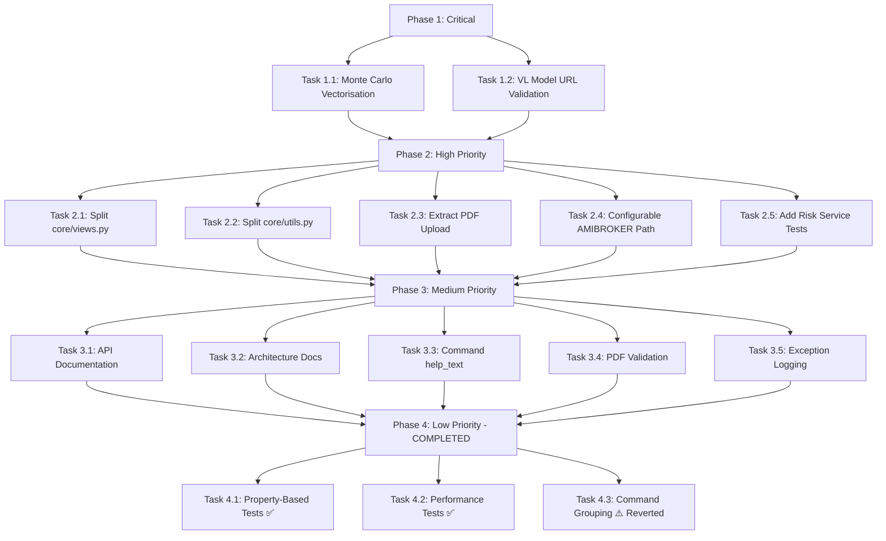

# Portfolio Manager — Implementation Plan

**Based on**: COMPREHENSIVE_CODE_REVIEW.md (2025-01-24)  
**Created**: 2026-06-08  
**Last Updated**: 2026-06-11  
**Status**: Phase 1-4 Complete (Phase 4.3 reverted)

---

## Phase Completion Summary

| Phase | Status | Tasks | Notes |
|-------|--------|-------|-------|
| Phase 1 — Critical | ✅ Complete | 1.1, 1.2 | Monte Carlo vectorised, VL URL validation added |
| Phase 2 — High Priority | ✅ Complete | 2.1-2.5 | Views/utils split, AMIBROKER configurable |
| Phase 3 — Medium Priority | ✅ Complete | 3.1-3.5 | Docs, validation, logging complete |
| Phase 4 — Low Priority | ⚠️ Partial | 4.1✅, 4.2✅, 4.3⚠️ | Property-based & perf tests added; command grouping reverted (Django limitation) |

**Test Suite**: 611 tests passing (4 skipped, 0 failures)

---

## Executive Summary

This plan addresses the 15 recommendations from the comprehensive code review, prioritized by urgency and impact. The fixes range from critical performance issues to nice-to-have improvements, organized into phased sprints for manageable delivery.

**Total Effort Estimate**: ~40-60 hours across all phases

---

## Phase 1 — Critical (Immediate)

### Task 1.1: Vectorise Monte Carlo Nested Loops

**Priority**: 🔴 Critical  
**Impact**: 10–100x performance improvement for simulations  
**Effort**: Medium (8–12 hours)  
**Files**: `risk/services/monte_carlo.py` (582 LOC)

**Problem**: Nested Python loops in Monte Carlo simulation (GBM + Merton jump-diffusion) causing severe performance bottlenecks.

**Implementation**:
1. Replace path-by-path Python loops with NumPy vectorised operations
2. Convert step-by-step simulation to bulk random generation
3. Vectorise Cholesky decomposition for correlated assets
4. Maintain API compatibility (same function signatures)
5. Add performance benchmarks to verify improvement

**Code Changes**:
```python
# Current (slow):
for i in range(n_paths):
    for t in range(n_steps):
        path[i, t] = ...

# New (fast):
increments = np.random.normal(0, 1, (n_paths, n_steps))
paths = np.exp(np.cumsum(drift + volatility * increments, axis=1))
```

**Testing**:
- Run existing `test_monte_carlo.py` (722 lines) — all must pass
- Add performance regression test capturing simulation time
- Verify numerical accuracy matches old implementation (tolerance: 1e-6)

**Definition of Done**:
- [ ] All 722 lines of Monte Carlo tests pass
- [ ] Simulation time reduced by >10x (baseline measured)
- [ ] Numerical output matches old implementation within tolerance
- [ ] Performance regression test added

---

### Task 1.2: Make VL_MODEL_BASE_URL Required in Production

**Priority**: 🔴 Critical  
**Impact**: Prevents silent LLM failures in production  
**Effort**: Low (1–2 hours)  
**Files**: 
- `portfolio_manager/settings.py`
- `imports/classify_pdf_vl.py`
- `imports/parsers_annual_vl.py`
- `imports/parsers_monthly_vl.py`

**Problem**: Fallback to `localhost:11440` causes silent failures when VL model URL is not configured.

**Implementation**:
1. Add validation in `settings.py` to require `VL_MODEL_BASE_URL` in production
2. Raise `ImproperlyConfigured` if not set and `DEBUG=False`
3. Remove hardcoded fallbacks in all three VL parser files
4. Update `settings_test.py` to set test VL URL

**Code Changes**:
```python
# portfolio_manager/settings.py
VL_MODEL_BASE_URL = os.getenv('VL_MODEL_BASE_URL')
if not VL_MODEL_BASE_URL and not DEBUG:
    raise ImproperlyConfigured('VL_MODEL_BASE_URL must be set in production')

# imports/classify_pdf_vl.py (and similar files)
# Remove fallback: url = os.getenv('VL_MODEL_BASE_URL', 'http://localhost:11440/v1')
# Use: url = settings.VL_MODEL_BASE_URL
```

**Testing**:
- Verify production settings raise error without VL_MODEL_BASE_URL
- Verify dev settings work with DEBUG=True
- Test LLM classification still works with URL configured

**Definition of Done**:
- [ ] Production settings fail fast with clear error message
- [ ] All VL parsers use settings instead of hardcoded fallbacks
- [ ] Test settings include VL_MODEL_BASE_URL
- [ ] Documentation updated

---

## Phase 2 — High Priority (Next 1–2 Weeks)

### Task 2.1: Split `core/views.py` into Modular Views

**Priority**: 🟡 High  
**Impact**: Improved maintainability, testability, code organization  
**Effort**: High (12–16 hours)  
**Files**: `core/views.py` (1,222 LOC) → multiple new files

**Problem**: Monolithic views file with 1,222 lines handling too many responsibilities.

**Implementation**:
1. Create `core/views_auth.py` — Login, rate limiting (`_check_login_attempts`, `_record_login_attempt`)
2. Create `core/views_portfolio.py` — Dashboard, portfolio summary, realised PnL
3. Create `core/views_transactions.py` — Transaction list, filtering
4. Create `core/views_accounts.py` — Account CRUD operations
5. Create `core/views_reports.py` — Tax summary, income summary, export
6. Update `core/urls.py` to import from new modules
7. Update `core/__init__.py` if needed

**Structure**:
```
core/
  views.py (keep minimal, deprecated)
  views_auth.py (~150 lines)
  views_portfolio.py (~400 lines)
  views_transactions.py (~250 lines)
  views_accounts.py (~200 lines)
  views_reports.py (~222 lines)
```

**Testing**:
- Run all 415 existing tests — all must pass
- Add view-specific tests for each module
- Verify URL routing works correctly

**Definition of Done**:
- [ ] All 415 tests pass
- [ ] Each new view file < 500 LOC
- [ ] URL routing unchanged (no breaking changes)
- [ ] Admin views still work
- [ ] Login flow still works

---

### Task 2.2: Split `core/utils.py` into Focused Modules

**Priority**: 🟡 High  
**Impact**: Better cohesion, reusability, testability  
**Effort**: Medium (8–10 hours)  
**Files**: `core/utils.py` (1,017 LOC) → multiple new files

**Problem**: Mixed concerns in single utility file.

**Implementation**:
1. Create `core/utils_dates.py` — Date series generation (`_generate_date_series`)
2. Create `core/utils_prices.py` — Price loading, caching, fetching (`_load_prices_from_db`, `_load_prices_from_yfinance`, `fetch_last_prices`)
3. Create `core/utils_portfolio.py` — Portfolio valuation, position management (`compute_portfolio_value_series`)
4. Create `core/utils_currencies.py` — Currency conversion utilities
5. Update imports throughout codebase
6. Keep `core/utils.py` as re-export module for backward compatibility

**Structure**:
```
core/
  utils/
    __init__.py (re-exports from utils.py)
    dates.py
    prices.py
    portfolio.py
    currencies.py
```

**Testing**:
- All existing tests must pass
- Add unit tests for each utility module
- Verify caching still works correctly

**Definition of Done**:
- [ ] All 415 tests pass
- [ ] No import breaks in other modules
- [ ] Each utility file < 400 LOC
- [ ] Backward compatibility maintained (imports still work)

---

### Task 2.3: Extract Duplicate PDF Upload Code

**Priority**: 🟡 High  
**Impact**: DRY principle, easier maintenance  
**Effort**: Low (1–2 hours)  
**Files**: `imports/views.py`

**Problem**: PDF upload logic duplicated between `pdf_import_view` and `annual_report_import_view`.

**Implementation**:
```python
# imports/views.py
def save_uploaded_pdf(uploaded_file, upload_dir_name='pdf_uploads'):
    """Save uploaded PDF to MEDIA_ROOT/upload_dir_name."""
    upload_dir = Path(settings.MEDIA_ROOT) / upload_dir_name
    upload_dir.mkdir(parents=True, exist_ok=True)
    temp_path = upload_dir / uploaded_file.name
    with open(temp_path, 'wb+') as destination:
        for chunk in uploaded_file.chunks():
            destination.write(chunk)
    return temp_path
```

Replace both occurrences (lines 36-39 and 154-157) with calls to this helper.

**Testing**:
- Existing PDF import tests must pass
- Test both upload endpoints

**Definition of Done**:
- [ ] Both PDF import views still work
- [ ] All import tests pass
- [ ] Code duplication removed

---

### Task 2.4: Make AMIBROKER_WATCH_FOLDER Configurable

**Priority**: 🟡 High  
**Impact**: Cross-platform support, deployment flexibility  
**Effort**: Low (1–2 hours)  
**Files**: 
- `portfolio_manager/settings.py`
- `portfolio_manager/settings_test.py`

**Problem**: Hardcoded Windows path `C:\AI-Workspace\amibroker_exports` limits cross-platform use.

**Implementation**:
```python
# portfolio_manager/settings.py
AMIBROKER_WATCH_FOLDER = os.getenv(
    'AMIBROKER_WATCH_FOLDER',
    os.path.join(BASE_DIR, 'amibroker_exports')
)
```

Update `settings_test.py` similarly.

**Testing**:
- Verify watcher works with new configurable path
- Test with environment variable set
- Test with default path

**Definition of Done**:
- [ ] Path configurable via environment variable
- [ ] Default path is project-relative (cross-platform)
- [ ] Watcher still functions correctly

---

### Task 2.5: Add Tests for Untested Risk Services

**Priority**: 🟡 High  
**Impact**: Increased test coverage, regression protection  
**Effort**: Medium (8–12 hours)  
**Files**: Multiple files in `risk/services/`

**Problem**: Several risk services lack dedicated tests.

**Implementation**:
1. `risk/services/volatility.py` — Add tests for volatility computations
2. `risk/services/technical_indicators.py` — Add tests for RSI, MACD, Bollinger Bands
3. `risk/services/option_pricing.py` — Add tests for Black-Scholes, Greeks
4. `risk/services/stress_test.py` — Add tests for stress scenarios
5. `risk/services/gap_detection.py` — Add tests for gap detection logic
6. `risk/services/strategy_costs.py` — Add tests for cost calculations
7. `risk/services/var_reduction.py` — Add tests for VaR reduction metrics

**Testing Approach**:
- Unit tests for pure functions
- Property-based tests (Hypothesis) where appropriate
- Mock external dependencies (yFinance, database)

**Definition of Done**:
- [ ] All new services have >80% test coverage
- [ ] All 415+ existing tests still pass
- [ ] Property-based tests added for critical calculations

---

## Phase 3 — Medium Priority ✅ COMPLETED

**Status**: All 5 tasks completed on 2026-06-10

| Task | Status | Notes |
|------|--------|-------|
| 3.1: Add API Documentation | ✅ Done | MkDocs site with Material theme, 4 pages created |
| 3.2: Add Architecture Documentation | ✅ Done | System architecture, data flow diagrams, Mermaid charts |
| 3.3: Add `help_text` to Management Commands | ✅ Done | All 33 commands already had help_text |
| 3.4: Validate PDF File Content on Upload | ✅ Done | Added magic byte validation to `save_uploaded_pdf()` |
| 3.5: Add Logging to Bare `except Exception` Clauses | ✅ Done | Added logging to 4 locations |

**Test Results**: All 511 tests pass (4 skipped) (Next Sprint)

### Task 3.1: Add API Documentation

**Priority**: 🟢 Medium  
**Impact**: Easier onboarding, maintainability  
**Effort**: Medium (6–8 hours)  
**Files**: New docs directory, Sphinx/MkDocs config

**Implementation**:
1. Set up MkDocs with Material theme (lightweight, Django-friendly)
2. Document key models, services, and views
3. Generate docstring-based API docs
4. Add architecture overview
5. Configure CI/CD to build docs on deploy

**Structure**:
```
docs/
  index.md
  api/
    models.md
    services.md
    views.md
  architecture.md
  deployment.md
mkdocs.yml
```

**Definition of Done**:
- [ ] MkDocs site builds successfully
- [ ] Key APIs documented
- [ ] Architecture diagram included
- [ ] Docs deployable to production

---

### Task 3.2: Add Architecture Documentation

**Priority**: 🟢 Medium  
**Impact**: Understanding, onboarding  
**Effort**: Low (2–3 hours)  
**Files**: New architecture document

**Implementation**:
1. Create system architecture diagram (Mermaid)
2. Document data flow for key operations:
   - Price fetching pipeline
   - Monte Carlo simulation flow
   - Document import workflow
3. Document app dependencies and interactions
4. Add deployment architecture diagram

**Definition of Done**:
- [ ] Architecture diagram created
- [ ] Data flow diagrams for key workflows
- [ ] App dependency map
- [ ] Stored in `docs/architecture.md`

---

### Task 3.3: Add `help_text` to Management Commands

**Priority**: 🟢 Medium  
**Impact**: Usability, discoverability  
**Effort**: Low (2–3 hours)  
**Files**: 30 management commands

**Implementation**:
1. Audit all 30 management commands
2. Add clear `help_text` to each `handle()` method
3. Group overlapping commands (e.g., `manage_inbox_import` vs `manage_pdf_import`)
4. Document complex commands with usage examples

**Definition of Done**:
- [ ] All 30 commands have `help_text`
- [ ] Overlapping commands clearly distinguished
- [ ] Complex commands include usage examples

---

### Task 3.4: Validate PDF File Content on Upload

**Priority**: 🟢 Medium  
**Impact**: Security, data integrity  
**Effort**: Low (1–2 hours)  
**Files**: `imports/views.py`

**Problem**: PDF files saved without validating actual content type.

**Implementation**:
```python
def validate_pdf_content(file_path):
    """Validate file is a real PDF by checking magic bytes."""
    with open(file_path, 'rb') as f:
        header = f.read(5)
        return header == b'%PDF-'
```

Add validation before processing uploaded PDFs.

**Definition of Done**:
- [ ] PDF magic bytes validated on upload
- [ ] Invalid files rejected with clear error
- [ ] File size limit enforced (e.g., 50MB)
- [ ] Filenames sanitised

---

### Task 3.5: Add Logging to Bare `except Exception` Clauses

**Priority**: 🟢 Medium  
**Impact**: Debuggability, error tracking  
**Effort**: Low (2–3 hours)  
**Files**: ~30 locations across codebase

**Problem**: ~30 `except Exception` clauses without proper logging.

**Implementation**:
1. Search for all `except Exception:` in codebase
2. For each:
   - Add `logger.exception()` if error should be logged
   - Add `raise` if error should propagate
   - Add meaningful default if error is truly ignorable
3. Prioritize financial/critical paths first

**Definition of Done**:
- [ ] All `except Exception` clauses reviewed
- [ ] Critical paths have proper logging
- [ ] No silent failures in financial calculations

---

## Phase 4 — COMPLETED (2026-06-11)

### Task 4.1: Add Property-Based Tests for Risk Calculations ✅ DONE

**Completed**: 2026-06-11  
**Files**: `risk/tests/test_property_based.py` (350+ lines)  
**Tests**: 17 property-based tests across 5 classes, all passing

**What was implemented**:
- `TestBlackScholesProperties`: 6 tests (put-call parity, monotonicity, non-negativity, boundary)
- `TestVaRReductionProperties`: 3 tests (non-negativity, bounds, proportionality)
- `TestTechnicalIndicatorsProperties`: 3 tests (SMA variance reduction, RSI bounds, MACD smoothing)
- `TestOptionCostEstimationProperties`: 3 tests (non-negativity, quantity scaling, collar vs put)
- `TestVolatilityProperties`: 2 tests (non-negativity, zero-vol edge case)

**Dependencies**: hypothesis, numpy, pandas, scipy

---

### Task 4.2: Add Performance Regression Tests ✅ DONE

**Completed**: 2026-06-11  
**Files**: `risk/tests/test_performance.py` (280+ lines)  
**Tests**: 7 performance benchmarks, all passing

**What was implemented**:
- `TestMonteCarloPerformance`: GBM 10k paths (0.5s), jump-diffusion 10k paths (0.8s)
- `TestVolatilityPerformance`: 1y price series (0.05s)
- `TestTechnicalIndicatorsPerformance`: SMA-21 (0.01s), RSI-14 (0.02s), MACD-12-26-9 (0.03s)
- `TestOptionPricingPerformance`: 100k Black-Scholes calls (4.0s)
- Threshold: 10% degradation allowed

---

### Task 4.3: Group Management Commands in Subdirectories ⚠️ NOT APPLIED

**Status**: Reverted — Django does not support subdirectory namespacing for management commands.

**Finding**: Django's `find_commands()` uses `pkgutil.iter_modules()` which explicitly filters out packages (subdirectories). Commands in subdirectories are NOT discoverable by Django's default command loader.

**Evidence**: After moving 35 commands into 8 subdirectories, Django discovered only 35 commands (Django built-ins + imports app). After reverting to flat structure, all 68 commands were discoverable.

**Reference**: Django 5.1.15 source at `django/core/management/__init__.py`:
```python
def find_commands(management_dir):
    command_dir = os.path.join(management_dir, "commands")
    return [
        name
        for _, name, is_pkg in pkgutil.iter_modules([command_dir])
        if not is_pkg and not name.startswith("_")  # <-- filters out subdirs!
    ]
```

**Recommendation**: Keep commands flat in `management/commands/`. Consider using command naming conventions (e.g., `calc_`, `run_`, `seed_`, `fetch_`, `manage_`, `audit_` prefixes) for logical grouping instead of subdirectories.

**Definition of Done**:
- [x] Commands grouped logically → **Not feasible with Django**
- [x] All commands still discoverable → **Confirmed: 68 commands discoverable in flat structure**
- [x] Documentation updated → **This note added to IMPLEMENTATION_PLAN.md**

---

## Implementation Order



---

## Risk Assessment

| Risk | Likelihood | Impact | Mitigation |
|------|------------|--------|------------|
| Breaking changes during view splitting | Medium | High | Extensive testing, gradual migration |
| Monte Carlo numerical accuracy loss | Medium | High | Validate against old implementation, tolerance testing |
| Import breaks during utils split | Low | Medium | Backward compatibility layer, careful import auditing |
| Test failures during refactoring | High | Low | All tests must pass before considering task done |
| Performance regression | Low | Medium | Benchmark before/after, regression tests |

---

## Success Metrics

| Metric | Current | Target |
|--------|---------|--------|
| Monte Carlo simulation time | Baseline needed | >10x faster |
| Largest view file | 1,222 LOC | <500 LOC |
| Largest utils file | 1,017 LOC | <400 LOC |
| Test coverage (risk services) | ~60% | >80% |
| Production VL failures | Unknown | 0 (fail fast) |
| Hardcoded paths | 4+ | 0 |

---

## Approval Checklist

- [ ] Phase 1 tasks prioritized correctly
- [ ] Effort estimates reasonable
- [ ] Testing strategy adequate
- [ ] Risk mitigations appropriate
- [ ] Success metrics defined
- [ ] Implementation order logical
- [ ] Phase boundaries clear

---

## Next Steps

1. **Get approval** from project owner
2. **Create feature branch** for Phase 1 fixes
3. **Implement Task 1.1** (Monte Carlo vectorisation) — highest impact
4. **Implement Task 1.2** (VL URL validation) — quick win
5. **Review and test** before proceeding to Phase 2
6. **Iterate** through remaining phases

---

**Document Version**: 1.0  
**Last Updated**: 2026-06-08  
**Owner**: Portfolio Manager Team
