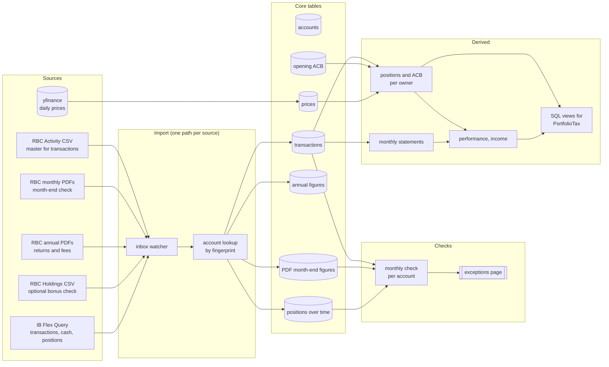

# Portfolio manager: target architecture

Agreed by tdw in the design sessions of 2026-10-21 and 2026-10-22, after the four audits in `docs/audit/`. Replaces the June 2026 version of this file.

This is the target, not the current state. The clean-up order at the end says how the code gets there. Where this file and an audit's Decisions section disagree, this file wins.

## 1. Purpose

- What the data is used for should **make money or be entertaining**. Importing history on its own does neither.
- **Without clean imported data there is no app.** Data quality comes first; features come after.
- What tdw wants to see: **performance** (per account and per owner), **income** by type, **ACB and unrealised gains** per owner, and later a redone **risk** view (risk-adjusted returns, Sharpe, Sortino, CVaR, basic hedging).
- The app is the **source of truth for what is owned and earned**. Tax planning is done by the separate PortfolioTax app (a tax-forecasting app), which reads from this one.

## 2. Principles

1. **One import path per source.** No second copies of import logic.
2. **Nothing is silently accepted.** Every import is duplicate-checked, every month is checked against the broker's own figures, and every difference goes to the exceptions page.
3. **The app stores no account numbers.** It stores a fingerprint and the last 4 digits; everywhere else, the account **name** is shown (section 5).
4. **Parked means parked:** leave the code and tables in place, don't run them, don't build on them, and don't let live pages query them.
5. **Sensitive data stays local.** The database is on mercury; source files stay on saturn; nothing leaves through the parsers (the VL model is local).

## 3. Data flow

## 4. Sources

| Source | Role | Notes |
|---|---|---|
| RBC Activity CSV | **The master** for transactions (from Oct 2019) | Any period can be exported. |
| RBC monthly PDFs | **Month-end check per account**: holdings, cash, market value. Also the only source for history before Oct 2019 | Only holdings, cash and totals are read. The PDF transaction lists are **not** used (unreliable). RBC keeps about 7 years, so downloading can catch up at any time. |
| RBC annual PDFs | RBC's own returns, fees and charges | One row per account, year and currency. |
| RBC Holdings CSV | Optional bonus check | Valid only when exported **per single account**; a multi-account export sums the cash and is useless. |
| IB Flex Query | Transactions, cash and positions per account, for any date range | Not imported yet. Self-checking (positions and cash come with the trades). Automatic fetching via IB's web service is a later decision. |
| yfinance | Daily prices | Stored in one table, refreshed by a command; pages never fetch live. |

## 5. Accounts and account numbers

- **`core_account` is the single source of truth** for accounts. `RBC_ACCOUNTS` and `RBC_DEFAULT_ACCOUNT` leave `.env`.
- **No account numbers are stored.** Each account has:
  - a **fingerprint**: an HMAC of the full account number with a secret key;
  - the **last 4 digits**;
  - a **name**: short, unique, required, contains no digits. It can be renamed (e.g. RRSP → RRIF; RBC keeps the number, so a conversion is a rename plus a category change).
- **The secret key** is the only secret: it lives in `.env`, with a copy in tdw's password manager. If it's lost, the numbers are re-entered from a statement.
- Numbers are entered **once** (an "add account" form or a one-off command) and never saved.
- **The integer `id` is the primary key** and what every table links to. A name is never used as a key. A few SQL views that join the name in may be added for work in SSMS.
- **Display rules:**
  - every screen, report and export shows the **account name**;
  - the **accounts page** is the only page with digits, and shows the **last 4** only;
  - URLs use the integer `id`;
  - logs, file names and JSON logs show the account name.
- **At import:**
  - the parser reads the number from the file, fingerprints it and looks up the account; **an unknown fingerprint is rejected** (this replaces the `RBC_ACCOUNTS` whitelist). IB account ids work the same way;
  - free text that may contain a number (transaction notes, PDF descriptions, file names) is **scrubbed**: the account name replaces the number before anything is stored;
  - files moved to `processed/` are renamed to `<date>_<type>_<account name>_<hash8>.<ext>`; the original name is not stored.
- **Logs:** a logging filter finds anything that looks like an account number, fingerprints it, and replaces only real matches with the account name (dates and amounts are left alone).
- **Source files** in `inbox/` and `processed/` still contain the real numbers (they're the broker's documents). They are the archive, stay on saturn, and are git-ignored.
- Never paste account numbers, `.env` content, log lines, statement files or VL JSON output into a cloud AI. See the rule in `AGENTS.md`.

## 6. Imports

| Source | Canonical path |
|---|---|
| Activity CSV | `import_csv` |
| Holdings CSV | `import_csv --holdings` |
| PDFs (monthly and annual) | `manage_inbox_import` |
| Prices | `fetch_historical_prices` |
| IB Flex Query | to be built |

- **The inbox watcher calls only these paths.**
- **Every file is logged** in `FileImportLog`, holdings imports included.
- **Duplicates** are detected on the file's content (`content_hash`), plus row-level keys: the `tx_hash` for transactions; account, statement date and currency for PDF statements (not the file name).
- **Sanity checks:** no transaction dates after the statement date or after today.
- `BrokerStatement` stays one per imported file, with `period_start` / `period_end` filled from the first and last transaction date in the file.
- **PDF parsing:** a deterministic text parser for holdings, cash and totals, with VL as the fallback (to be confirmed by the check of `imports/parsers_pdf.py`, step 12).

## 7. Checks

- **The monthly check** runs per account and month:
  1. replay the account's transactions up to month-end;
  2. compare quantities per security, and cash, with the month-end PDF (and with a Holdings CSV when one exists);
  3. compare the total market value.
- **Every difference becomes an exception** on the exceptions page, and stays there until it is **fixed** (a correction) or **accepted** (with a note).
- This replaces the old reconciliation design. The old `reconcile` command, `CoreReconciliation` and the reconciliation scripts stay parked or go.
- When a position whose ACB came from an opening value is sold, the app's ACB is compared with the broker's T5008; a difference becomes an exception.

## 8. Derived data

- **Positions over time** = transactions replayed, confirmed monthly by the PDF (section 7).
- **ACB and capital gains** are calculated **per owner** (taxpayer), not per account, and are not copied from the broker's book cost.
  - Registered accounts don't need ACB.
  - For positions held before the CSV starts (Oct 2019), an **opening ACB** per position on 2019-09-30 is entered once, from RBC's book cost in the anchor snapshot, and marked "source: RBC book cost".
  - The rules (pooling of identical properties per taxpayer, joint accounts) are to be confirmed with the accountant.
- **Monthly statements:** one method, forward from transactions, checked against the PDF. The reverse and batch generators go.
- **Annual reports:** aggregated from the monthly statements; RBC's annual figures are shown next to them.
- **Performance and income:** per account and per owner; income split by type (Canadian dividends, foreign dividends, interest, capital-gains distributions).
- **For PortfolioTax:** SQL views on mercury, per owner:
  - unrealised gains in the taxable accounts;
  - income by type this year;
  - realised gains this year.

  The final split of fund distributions only arrives with the T3/T5 slips after year-end; until then the forecast uses estimates.

## 9. Prices

- `core_historicalprice` is the **only** price store, refreshed by `fetch_historical_prices`.
- Fixed-price instruments come from `FixedPriceConfig` and are never sent to yfinance.
- Symbols are mapped to Yahoo's names (e.g. the `.TO` suffix for TSX listings).
- Adjusted or raw prices are chosen explicitly (`auto_adjust`), the same everywhere.
- "Top movers" and every other page read stored prices; no page fetches from the internet.
- The risk module's own price tables stay parked. Whether the redesigned risk module uses `core_historicalprice` is decided with that redesign.

## 10. Views

- **Dashboard:** current value and movement.
- **Accounts:** the only page with (last-4) digits.
- **Performance:** per account and per owner.
- **Income:** by type and year.
- **Exceptions:** everything the checks have flagged.
- **Later:** risk (after the redesign, on clean data).

## 11. Parked and removed

- **Parked:**
  - the risk module (to be redone on clean data, after the features in step 17);
  - the ledger (`write_ledger`, `close_ledger_month`, the ledger tables and view);
  - the old reconciliation (`reconcile`, `CoreReconciliation`, the reconciliation scripts and SQL);
  - `rebuild_position_history` and `rebuild_positions_from_transactions`.
- **Removed:**
  - the `auto_import` command, `import_statements`, `manage_pdf_import`, `manage_annual_report_import`;
  - the web upload pages and `imports/parsers_annual.py` (`imports/parsers_pdf.py` waits for step 12);
  - `DividendSchedule`, the mkdocs site and the debug files;
  - committed junk (report artifacts, `events.jsonl`, `calc_march.py`, `login_test.html`).
- **Moved to history:** the finished one-off scripts, old docs and old specs (audit 3).

## 12. Clean-up order

Each step is a small branch through the Pi procedure (`AGENTS.md`), except step 7, which tdw does. **No new data is imported until phase 2 is done.**

**Phase 0: tidy up (no behaviour changes)**
1. Repo hygiene: `mssql-django` in `requirements.txt`, `.env.*` in `.gitignore` (keep `.env.example`), the cloud-AI rule in `AGENTS.md`, the JSON-log correction in `AGENTS.md`, `CONVENTIONS.md` folded into `AGENTS.md`.
2. Junk out (audit 3 batch 2).
3. Move to history (audit 3 batches 3, 4 and 7, one branch).
4. Stale docs and parked labels (audit 3 batches 5 and 6).

**Phase 1: remove dead code**
5. One import path per source; rewire the watcher (audit 3 batch 1).
6. `DividendSchedule` out, with a migration (audit 3 batch 8).

**Phase 2: accounts**
7. Browser tests running on saturn (audit 3 batch 9, tdw).
8. Fingerprints and last 4 in `core_account`, the command to enter the numbers, account lookup by fingerprint in the importers; `RBC_ACCOUNTS` goes.
9. Names everywhere (screens, reports, exports); integer ids in URLs.
10. Old number columns out (migration), and a one-off scrub of existing free text.
11. Log filter and safe file names.

**Phase 3: imports you can trust**
12. The text-parser check, then holdings, cash and totals from the PDFs with VL as the fallback.
13. PDF duplicate check, date sanity check, `BrokerStatement` periods, logging of holdings imports.

**Phase 4: checks**
14. The monthly check and the exceptions page.
15. The opening-ACB table, then the known gaps in the taxable RBC accounts.

**Phase 5: prices**
16. Prices from the stored table, Yahoo symbol mapping, `auto_adjust`; pages stop querying parked tables.

**Phase 6: features**
17. Performance, income, ACB per owner, and the views for PortfolioTax.

**In parallel:** the IB import, built like the RBC one from step 8 onwards (tdw first sets up a Flex Query in IB).

## 13. Known issues (first run on saturn Ubuntu, 2026-10-21)

Not blocking; each is covered by a step above.

- yfinance is asked for fixed-price funds, and for TSX symbols without the `.TO` suffix; empty results then fail as `decimal.ConversionSyntax` (step 16).
- `yf.download()` is called without an explicit `auto_adjust` (step 16).
- Stored prices end on 2026-05-21; "top movers" fetches live prices on every page load (step 16).
- A page queries the parked `AlertHistory` with a naive datetime (step 16).
- The `fitz` import is deprecated (use `pymupdf`), and WeasyPrint renders a PDF every time Django loads (step 1, or the first branch that touches them).
- `requirements.txt` names `django-mssql-backend`; the app actually needs `mssql-django` (step 1).
- `OPENAI_API_KEY`, `OPENAI_BASE_URL` and `AIDER_MODEL` in `.env` are not read by any code (delete them from every `.env`).

## 14. Still open

- The exact ACB rules per owner (pooling, joint accounts): to confirm with the accountant before step 17.
- How PortfolioTax reads the views (same server, separate databases): designed with step 17.
- Automatic IB fetching via IB's web service.
- The risk redesign.
