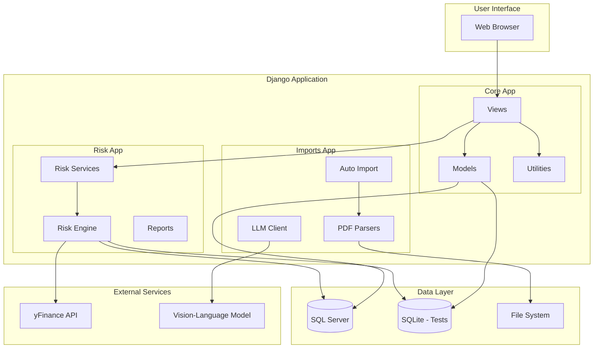
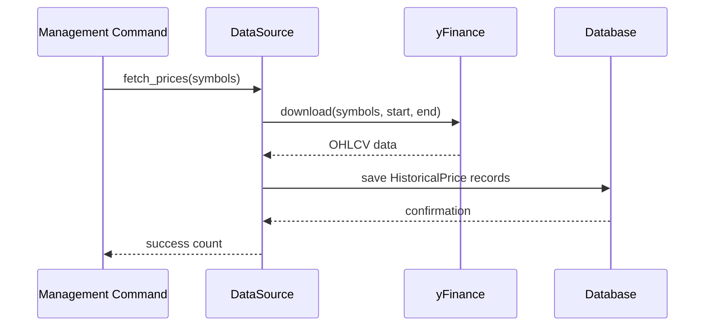
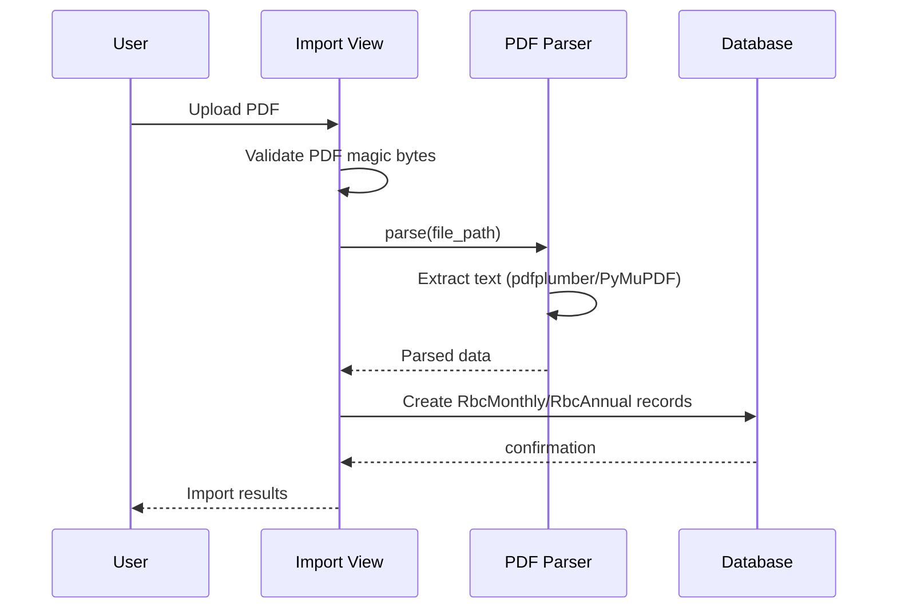
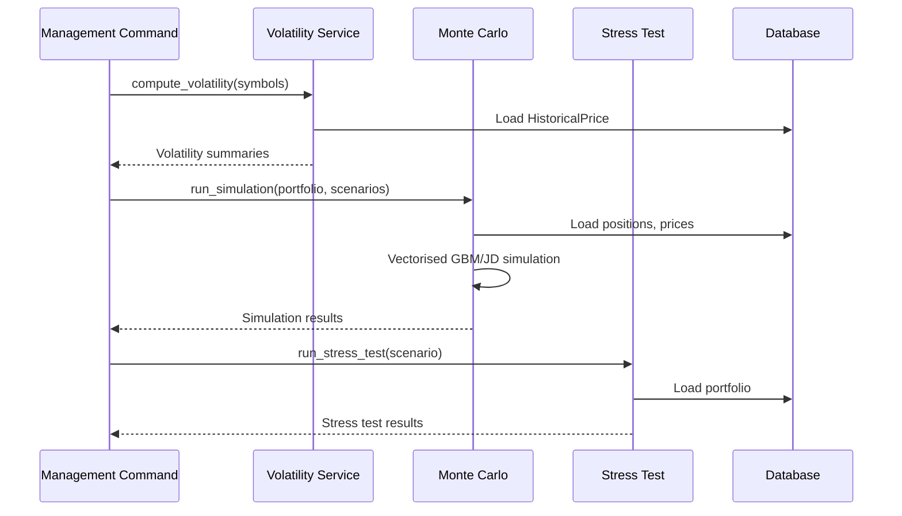

# Architecture Overview

## System Architecture

## Data Flow

### Price Fetching Pipeline

### PDF Import Workflow

### Risk Analytics Pipeline

## App Dependencies

| App | Depends On | Used By |
|-----|-----------|---------|
| `core` | Django ORM | Views, Management Commands |
| `imports` | `core`, `llm_client` | Auto Import, PDF Views |
| `risk` | `core`, `imports` | Risk Engine, Reports |

## Key Design Decisions

1. **SQLite for Tests**: All tests use SQLite in-memory database for speed and isolation
2. **SQL Server for Production**: Production uses SQL Server for enterprise-grade reliability
3. **Mocking External Services**: yFinance and VL models are mocked in tests
4. **Pure Python Services**: Risk services take DataFrames/arrays as input — independently testable
5. **Fallback PDF Libraries**: Try pdfplumber → PyMuPDF → plain text for maximum compatibility
