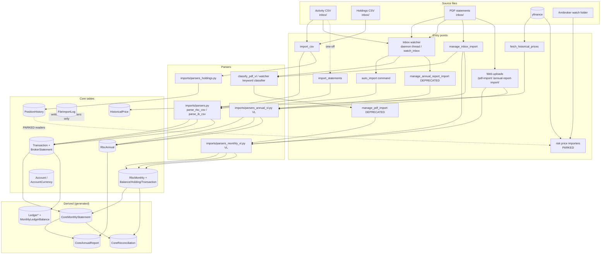

# Audit 2 of 4 — Data flow

Scope: every way data gets into the database, and every derived-data pipeline.
Method: grep + targeted reads of `imports/`, `core/management/commands/`, `core/utils/`, `imports/management/commands/`, `risk/management/commands/` (parked module — read paths only). Row counts referenced from `docs/audit/01-data-model.md` (PortfolioDEV, Oct 20 2026). No code was changed.

The risk module is **parked** (tdw's decision): its internals are not analysed here; only the places where it reads core data or has its own import paths are noted.

---

## 1. Flow diagram

Files move `inbox/ → processed/` on success, `inbox/ → processed/errors/` on failure
(all movers retry 5× on Windows file locks via `_move_file`). PDF parse output is
dumped as JSON to `processed/json_logs/` by `manage_inbox_import` (every file;
`*_ERROR.json` when errors) and by the deprecated commands (errors only).
AGENTS.md says "JSON only for failed imports" — `manage_inbox_import` actually writes
a JSON log for every processed PDF.

---

## 2. Ingest entry points

### 2.1 Activity CSV → `Transaction`

There are **three parallel CSV→Transaction code paths** that all share the parser
`imports/parsers.py` but duplicate the DB-write logic:

| | `import_csv` (canonical) | `auto_import` command | `import_statements` |
|---|---|---|---|
| Code | `core/management/commands/import_csv.py` → `imports/auto_import.py` (function) | `imports/management/commands/auto_import.py` (own copy of the write logic) | `imports/management/commands/import_statements.py` (own copy) |
| Trigger | manual; **not** used by the watcher | **the watcher's CSV path** (`call_command('auto_import')`) | manual one-off `--file X --broker RBC\|IB` |
| Broker detection | hardcoded `'RBC'` | content sniff (`Activity Export` → RBC, else IB) | required flag |
| Account matching | normalises to 8 digits, `Account.objects.get()`, **refuses to auto-create** (skips + warns) | `Account.objects.get_or_create` — **auto-creates accounts**, raw (un-normalised) id | normalised lookup (like import_csv) |
| PRACEF skip | explicit skip in `auto_import()` **and** parser whitelist | none explicit — relies on parser whitelist | parser whitelist |
| Dedup, file level | `FileImportLog.content_hash` (sha256) → skip before parse | same | same |
| Dedup, row level | `compute_tx_hash` **with `row_number`**, keyword args | `compute_tx_hash` **positional args are swapped** (see F3) and no `row_number` | same swapped positional args (F3) |
| Writes | `BrokerStatement` (1/file), `Transaction`, `FileImportLog`, `TransactionType` (auto-create) | same + auto-creates `Account` | same |
| FileImportLog | yes (skipped if content-hash duplicate found first) | yes (incl. `error` rows) | yes |
| Files | `inbox/*.csv` (skips `Holdings*`, `*dividend*`) → `processed/` or `processed/errors/` | `inbox/*.csv` → `processed/` / `processed/errors/` | single named file, not moved |
| Side files | `docs/reconciliation/CSV_Activity_Imported.csv`, `CSV_Activity_Rejected.csv`, `CSV_Duplicates.csv` | rejection JSON via `imports/rejection_log.py` → `IMPORT_LOGS_DIR` | rejection log |

Parser details (`imports/parsers.py::parse_rbc_csv`):
- Column map fixed by position (date, activity, symbol, qty, price, settlement, account, value, currency, notes); reads the `Exchange Rate: 1 USD = x CAD` line for `exchange_rate_cad`.
- **Account whitelist**: rows whose account id is not in `settings.RBC_ACCOUNTS` (env `RBC_ACCOUNTS`) are rejected as "Unknown account" — this is also what blocks `PRACEF…` goal-container rows in both CSV paths.
- Type normalisation maps raw strings to canonical codes; unknown codes are auto-registered in `TransactionType`.
- `amount_cad` = `amount × exchange_rate_cad` (signed; commission already inside amount).

**Why all 2,844 transactions share one `BrokerStatement`:** a `BrokerStatement` is a
*file wrapper*, not a monthly statement — every importer creates exactly one per CSV
file and hangs all of that file's transactions off it. The database was built from a
single consolidated "master" activity CSV (Phase F "CSV Master Import";
`scripts/export_all_activity.py` merges every activity CSV into one master file),
imported 2026-08-17. So one file → one statement → all 2,844 rows. That is *by
design at the file level*, but it means: no per-month/per-source provenance, and
`BrokerStatement.period_start`/`period_end` (added in Phase F for exactly this) are
**never set by any importer**. Re-importing the same file is a no-op via the
content-hash check.

### 2.2 Holdings CSV → `PositionHistory`

| | Holdings import |
|---|---|
| Entry point | `import_csv --holdings [--dry-run]` (manual) |
| Parser | `imports/parsers_holdings.py::import_holdings_snapshot` |
| Tables | `PositionHistory` only |
| Account matching | 8-digit normalisation, existing `Account` required (skip otherwise); `PRACEF`/`UNKNOWN` skipped at file and row level |
| Dedup | skip if a row with same (account, symbol, currency, `date_from`) exists; closes the previous open row (`date_to = snapshot_date − 1`) |
| FileImportLog | **no** — holdings imports are not logged |
| Files | `inbox/Holdings*.csv` → `processed/` / `processed/errors/` |
| Snapshot count | DB has 64 rows, 2019-09-30 → 2026-08-02 (the anchor snapshots) |

Two alternative writers of the same table (maintenance/rebuild):
- `rebuild_position_history` — re-derives `date_to` chains from existing rows (no new data).
- `rebuild_positions_from_transactions` — replays BUY/SELL from the earliest snapshot anchor and **rebuilds** PositionHistory from Transactions (parallel source of truth for the same table).

### 2.3 Monthly PDF → `RbcMonthly` + children

Three writers, all via VL parser `imports/parsers_monthly_vl.py` (VL model via
`imports/llm_client.py`, env-driven):

| | `manage_inbox_import` (canonical) | `manage_pdf_import` (DEPRECATED) | web `/pdf-import/` |
|---|---|---|---|
| Code | `core/management/commands/manage_inbox_import.py` | `core/management/commands/manage_pdf_import.py` | `imports/views.py::pdf_import_view` |
| Classification | VL `classify_pdf_vl.classify_pdf` (annual/monthly/unknown) | none (all inbox PDFs treated as statements; annuals filtered by filename prefix in the watcher) | none (assumed monthly) |
| Tables | `RbcMonthly`, `RbcMonthlyBalance`, `RbcMonthlyHolding`, `RbcMonthlyTransaction` (bulk_create), `FileImportLog` | same | `RbcMonthly`, `RbcMonthlyBalance`, `RbcMonthlyTransaction` — **no holdings, no FileImportLog** |
| Dedup key | (account, statement_date, currency, **file_name**) | (account, statement_date, currency) — file_name deliberately excluded | (account, statement_date) — ignores currency |
| Account matching | `_get_or_create_account`: 8-digit normalisation, **auto-creates** `Account` named "Auto-created from PDF: …" | same auto-create pattern | requires existing Account (error otherwise) |
| Files | `inbox/*.pdf` (non-recursive) → `processed/` / `processed/errors/` + JSON log every file | same, JSON only on error | uploaded file saved to `MEDIA_ROOT/pdf_uploads`, deleted after parse |

Notes:
- The PDF path **does not consult `RBC_ACCOUNTS`** — auto-created accounts are exactly
  what `merge_duplicate_accounts` (uses `RBC_ACCOUNTS` as canonical list) exists to
  clean up afterwards.
- `clean_misclassified_annuals` deletes `RbcMonthly` sets created when the classifier
  mistook an annual report for a monthly statement — evidence this happens.
- `audit_rbc_data` is a 10-check validation command over the RBC tables (with `--fix`).
- `RbcMonthlyTransaction` is documented unreliable and used only for validation; the
  DB's max PDF transaction date is **2026-12-31 (in the future)** — at least one
  misparsed date survived (see G4).

### 2.4 Annual PDF → `RbcAnnual`

Same three-way duplication: `manage_inbox_import` (VL-classified), deprecated
`manage_annual_report_import` (filename must start "annual report"), web
`/annual-report-import/`. Parser: `imports/parsers_annual_vl.py`. Dedup:
(account, report_year, currency) exists → skip. One row per (account, year, currency);
DB has 105 rows (2017–2025). `FileImportLog` written by the two CLI commands, not the view.

### 2.5 Price fetching

| | `fetch_historical_prices` (core) | risk price importers (PARKED) |
|---|---|---|
| Source | yfinance | yfinance (`fetch_yfinance_prices`), Amibroker/AmiQuote CSV watch folder (`import_amibroker_prices`, `settings.AMIBROKER_WATCH_FOLDER`), `fetch_fx_rates`, `fetch_economic_indicators` |
| Tables | `HistoricalPrice` (close + USDCAD=X; delete-then-`bulk_create` per symbol; `--incremental` mode) | `MarketPriceHistory`, `DataQualityLog`, `VolatilitySummary`, `FxRate`, `EconomicIndicator` |
| Consumers | `core/utils/prices.py` → portfolio charts/performance (`core/utils/portfolio.py`) | risk engine only |
| State | 99,086 rows, active | **all empty — never run** |

`FixedPriceConfig` (RBF2010/RBF2014 @ $10) and `BrandingConfig` are admin-only config.

**Risk module reads of core data** (noted only, per parked decision):
`risk/services/backtest_engine.py` and `risk/services/metrics.py` read
`PositionHistory`; `risk/services/urgency_engine.py` reads `Account`. Nothing else in
risk touches core tables.

### 2.6 The inbox watcher

`imports/apps.py::ready()` starts a daemon thread when `runserver` runs
(`RUN_MAIN=true`), polling `settings.IMPORT_INBOX_DIR` every
`IMPORT_INBOX_POLL_INTERVAL` s (default 300); `watch_inbox` is the standalone version.
Per poll (`imports/watcher.py::_poll_once`):
- CSVs present → `call_command('auto_import')` — the **duplicate command**, not `import_csv`.
- PDFs present → classified by **keyword scan of page 1 text** (fitz) — a second,
  different classifier from the VL one — then routed to `manage_annual_report_import`
  and `manage_pdf_import`, i.e. **both commands AGENTS.md marks DEPRECATED**.
- It never calls `manage_inbox_import` or `import_csv --holdings`.

---

## 3. Derived data pipelines

| Pipeline | Reads | Writes | Dedup / idempotency | Entry points | State on PortfolioDEV |
|---|---|---|---|---|---|
| **Forward monthly statements** | `Transaction` (per account+currency), previous statement's ending, `AccountCurrency.starting_balance` | `CoreMonthlyStatement` | `update_or_create` (account, month, currency) | `generate_monthly_statements` cmd; views (`?regenerate=1`) | 1,089 rows 2020-01→2026-04 |
| **Reverse monthly statements** | `Transaction` + anchors from `RbcMonthly` (end market values) or `AccountCurrency.starting_balance` | `CoreMonthlyStatement` | same `update_or_create` | `/accounts/reverse-statements/` view | mixed into the 1,089 |
| **Batch statements** | `RbcMonthly` anchors per currency, `Transaction` | `CoreMonthlyStatement` + placeholder (zero-activity) statements, then annuals | same | `batch_generate_statements [--account] [--dry-run]`; views `?batch=1` | mixed in |
| **Annual reports** | `CoreMonthlyStatement` (aggregation) | `CoreAnnualReport` | per (account, year, currency) | `generate_annual_reports` cmd + view | 100 rows 2020→2026 |
| **Reconciliation** | `CoreMonthlyStatement` vs `RbcMonthly` (monthly) / `CoreAnnualReport` vs `RbcAnnual` (annual), $1 threshold | `CoreReconciliation` | `update_or_create` (account, type, period) | `reconcile` cmd; `/accounts/reconcile/` view | **0 rows — never run/stored** |
| **Ledger** | `Transaction` only | `LedgerAccount`, `LedgerEntry` (1–2 legs/tx, `source_transaction` FK), `MonthlyLedgerBalance` | skips txs that already have a `LedgerEntry`; skips months closed in `LedgerMonthClosure` | `write_ledger --all-open / --account --month`; `close_ledger_month` writes closures; `scripts/fix_write_ledger.py` | **all 4 tables 0 rows — never run** |
| **Holdings reconciliation** | `PositionHistory` + `Transaction` (replay) vs `RbcMonthlyHolding`/`RbcMonthlyBalance`/`RbcMonthly` | **nothing** — markdown reports only | n/a | `reconcile_holdings_from_snapshots`, `reconcile_holdings_cash` cmds; `scripts/reconcile_holdings.py`, `quantity_reconciliation*.py` | reports in `docs/reconciliation/` |
| **Gap analysis** | `Transaction` dates, `RbcMonthly` coverage | nothing (view only) | n/a | `/accounts/gap-analysis/` | live view |

`write_ledger` also has a code smell: it hardcodes `sys.path.insert(0, r'C:\AI-DevTeam\projects\portfolio_manager')` and calls `django.setup()` at import time (Windows-era leftover).

---

## 4. How to rebuild the database from the source files

In order (this is effectively what produced PortfolioDEV):

1. **Create accounts manually** (or via admin): `Account` + `AccountCurrency` rows.
   The CSV paths refuse to auto-create accounts, so this must come first. Set
   `RBC_ACCOUNTS` / `RBC_DEFAULT_ACCOUNT` in `.env` — without them every CSV row is
   rejected as unknown account.
2. **Activity CSVs** → `import_csv` (or drop in `inbox/` + watcher):
   `Transaction` + one `BrokerStatement` per file + `FileImportLog` + `TransactionType`.
   Idempotent via `tx_hash` (row) and `content_hash` (file).
3. **Holdings CSVs** → `import_csv --holdings`: `PositionHistory` snapshots
   (dedup by account/symbol/currency/date_from). Optionally `rebuild_positions_from_transactions`
   to densify the chains from transactions.
4. **PDFs** → `manage_inbox_import` (VL classify → monthly/annual):
   `RbcMonthly(+Balance/Holding/Transaction)`, `RbcAnnual`. Then run
   `merge_duplicate_accounts` (fixes PDF-auto-created accounts against `RBC_ACCOUNTS`)
   and `clean_misclassified_annuals` (removes annuals misclassified as monthlies).
5. **Prices** → `fetch_historical_prices [--incremental]`: `HistoricalPrice`.
6. **Statements** → `batch_generate_statements` (RBC-anchored, fills gaps) or
   `generate_monthly_statements --all` (forward) / reverse-statements view (anchored
   back-walk); then `generate_annual_reports --all`.
7. **Reconciliation** → `reconcile --all --type=both` → `CoreReconciliation`.
8. **Ledger** → `write_ledger --all-open` (never executed on this DB; months are all
   open because `LedgerMonthClosure` is empty).
9. Verification passes: `audit_rbc_data`, `reconcile_holdings_from_snapshots`,
   `reconcile_holdings_cash`, `scripts/verify_pdf_integrity.py`.

Steps 7 and 8 have never been run on PortfolioDEV; everything else has.

---

## 5. Findings

### Dead / duplicate paths

- **F1 — Three CSV→Transaction code paths.** `import_csv`→`imports/auto_import.py`
  (canonical, tested), `imports/management/commands/auto_import.py` (a full second
  implementation with different behaviour: auto-creates accounts, no 8-digit
  normalisation, no `settlement_date`, no PRACEF skip of its own), and
  `import_statements` (third copy, one-off file). They produce **different
  `tx_hash`es for the same row** (see F3), so cross-path dedup does not work.
- **F2 — The watcher runs the deprecated paths.** `imports/watcher.py` calls
  `auto_import`, `manage_pdf_import` and `manage_annual_report_import` — the two PDF
  commands AGENTS.md marks "DEPRECATED (do not use)" — and uses its own keyword
  classifier instead of the VL `classify_pdf_vl` that `manage_inbox_import` uses.
  `manage_inbox_import` and `import_csv` are never triggered by the watcher.
- **F3 — `auto_import` and `import_statements` call `compute_tx_hash` with swapped
  positional args**: both pass `amount` into the `currency` slot and `currency` into
  the `amount` slot (`core/models.py` signature is `…, price, currency, amount=None,
  row_number=None`). For BUY/SELL the hash silently differs from the canonical path;
  for non-trade types `Decimal(str(currency))` raises, failing the whole file into
  `processed/errors/`. The watcher's CSV path is therefore unreliable, and neither
  command dedups against rows imported via `import_csv`.
- **F4 — Dead parsers.** `imports/parsers_pdf.py` (pdfplumber regex monthly parser)
  has no callers outside the `__all__` list in `imports/__init__.py`.
  `imports/parsers_annual.py` (regex annual parser) is referenced only by a test.
  Both were superseded by the VL parsers.
- **F5 — Deprecated commands still wired in.** `manage_pdf_import` and
  `manage_annual_report_import` are deprecated but are exactly what the watcher calls
  (F2). `manage_pdf_import`'s dedup excludes `file_name` while
  `manage_inbox_import`'s includes it — re-importing the same statement under a new
  filename duplicates whole `RbcMonthly` trees on the inbox path.
- **F6 — Web upload views are a third PDF writer** (`/pdf-import/`,
  `/annual-report-import/`): no `FileImportLog`, no holdings rows, and the monthly
  dedup ignores currency (a USD statement is rejected as "duplicate" if CAD for that
  date exists). Unclear whether they are still used.

### Gaps

- **G1 — The ledger has never been run.** All four ledger tables are empty although
  `write_ledger` is complete and idempotent. Either the accounting layer is aspirational
  or it was simply never executed after the master CSV import.
- **G2 — Reconciliation results were never stored** (`core_reconciliation` 0 rows) even
  though the command and view exist and the underlying data (1,089 statements, 958
  RbcMonthly) is present.
- **G3 — One `BrokerStatement` for all 2,844 transactions** is by design (one per
  imported file; the DB was built from a single master CSV via
  `scripts/export_all_activity.py`), but the design has consequences: no per-month or
  per-source provenance, and `BrokerStatement.period_start`/`period_end` — added in
  Phase F for exactly this — are never populated by any importer.
- **G4 — Future-dated PDF transaction (2026-12-31).** A VL-misparsed date survived
  into `RbcMonthlyTransaction`. Harmless today (validation-only table) but it poisons
  `gap_analysis` and any script that takes max(date) as "data through". No date sanity
  gate exists in the PDF import.
- **G5 — `FileImportLog` has 1 row but the DB contains 958 `RbcMonthly` + 105
  `RbcAnnual` rows.** Every current PDF importer writes `FileImportLog`, so the bulk
  of the PDF imports either predate the logging, ran through a path that skipped it,
  or the log was cleared. The audit trail does not match the data.
- **G6 — Account-matching rules differ per path.** Activity CSV: `RBC_ACCOUNTS`
  whitelist + no auto-create. Holdings CSV: existing-Account required + PRACEF skip.
  PDF: no `RBC_ACCOUNTS` check + auto-create (then `merge_duplicate_accounts` cleans
  up). The `auto_import` command auto-creates from CSV too, contradicting the
  "do not auto-create accounts from CSV" rule in the canonical path.
- **G7 — Holdings imports are not logged** (no `FileImportLog` from
  `import_holdings_snapshot`), so the one-row log understates even CSV activity.
- **G8 — `write_ledger` hardcodes a Windows path** and calls `django.setup()` at
  import time; harmless on Windows, a smell (and potential wrong-path import) on Linux.
- **G9 — Two PositionHistory sources of truth.** Sparse Holdings-CSV snapshots vs
  transaction-replayed chains (`rebuild_positions_from_transactions`) overwrite the
  same table; whichever ran last wins, and risk (parked) reads this table.

---

## 6. Questions for tdw

1. Which CSV path is canonical — should the watcher call `import_csv` (and
   `manage_inbox_import`) instead of `auto_import`/`manage_pdf_import`/
   `manage_annual_report_import`, so the deprecated commands and the duplicate
   `auto_import` command can be deleted?
2. F3 looks like a real bug (swapped `compute_tx_hash` args in the `auto_import`
   command). Confirm, and should it be fixed or is deleting the command better?
3. `manage_inbox_import` dedups monthly PDFs *including* `file_name`,
   `manage_pdf_import` excludes it. Which is intended? (Inbox behaviour: same statement
   re-dropped under a new name = full duplicate tree.)
4. Are the web upload views (`/pdf-import/`, `/annual-report-import/`) still used?
   They skip `FileImportLog` and holdings.
5. Should the ledger be run (`write_ledger --all-open`) on PortfolioDEV, or is the
   accounting layer parked like risk?
6. Should reconciliation be run and stored, or is reconciliation done exclusively via
   the `scripts/` markdown reports?
7. `FileImportLog` (1 row) vs 958 PDF statements — was the log cleared, or did the
   bulk import predate logging? Do you want the audit trail backfilled?
8. Do you want a date sanity gate in the PDF import (reject `RbcMonthlyTransaction`
   dates > statement date / today) to prevent future-dated rows like 2026-12-31?
9. Should importers populate `BrokerStatement.period_start/period_end` (and maybe
   split statements per account/month), or should the single-master-CSV, single-statement
   model stay as is?
10. Dead code candidates: `imports/parsers_pdf.py`, `imports/parsers_annual.py`
    (tests only) — remove?
11. AGENTS.md says JSON logs exist only for failed imports, but `manage_inbox_import`
    writes one for every PDF. Which behaviour is the intended contract?
12. PositionHistory: which is the truth going forward — sparse Holdings-CSV snapshots
    or transaction-replayed chains? The two rebuild commands disagree by construction.
